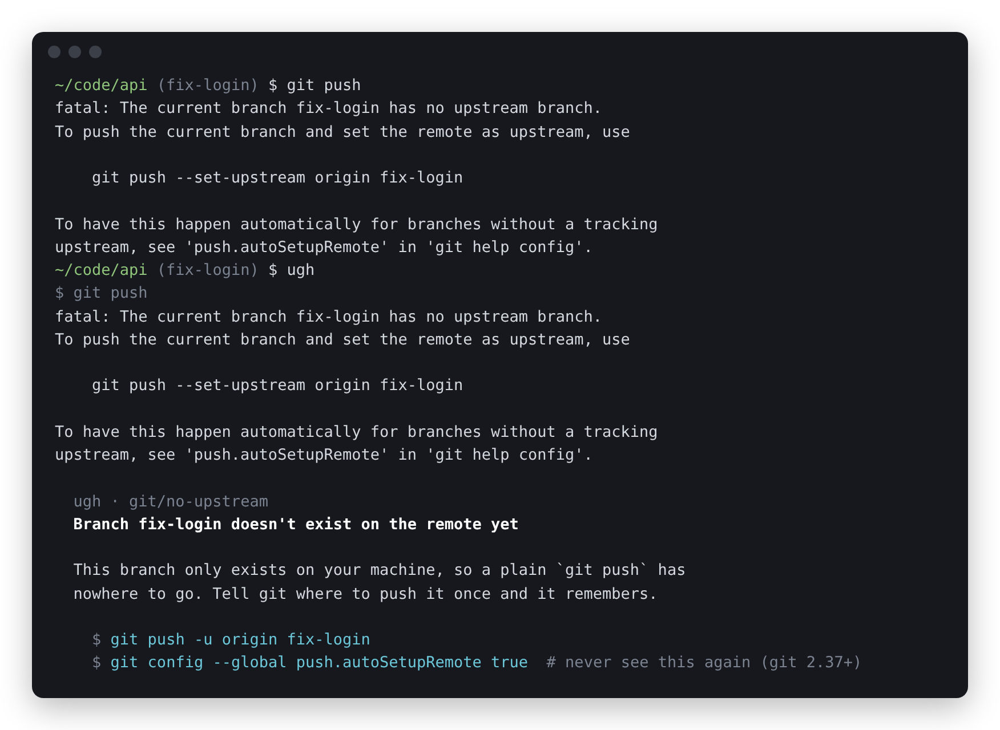

# ugh

[](https://github.com/themrsami/ugh/actions/workflows/ci.yml)
[](https://github.com/themrsami/ugh/releases)
[](LICENSE)

A command failed. Type `ugh`. It explains the error message in plain
English and shows the commands people normally use to fix it.



It works for the errors you keep running into with git, npm, Node,
Python, pip, Docker, ssh, Postgres, make, curl and the shell itself. It's
a single binary for Linux, macOS and Windows. It runs offline, needs no account or API key, and
answers in a few milliseconds, because there is no model behind it: just a
library of small rule files, one per error, that anyone can read and fix.

- [Install](#install)
- [Usage](#usage)
- [What it knows](#what-it-knows)
- [Teaching it a new error](#teaching-it-a-new-error)
- [Questions](#questions)

## Why this exists

Most error messages are fine if you already know what they mean.

`ENOSPC: System limit for number of file watchers reached` is an accurate
description of a problem that has nothing to do with disk space and goes
away with one sysctl line. `bash: /etc/hosts: Permission denied` after
`sudo echo ... > /etc/hosts` is correct too, and tells you nothing about
why sudo didn't help. You either know these or you lose ten minutes.

The usual ways out all have a catch. Searching gets you a 2014 thread
whose accepted answer is `chmod -R 777`. Pasting into a chatbot works
until the output has a hostname, a token or a customer's name in it, or
you're on a server with no browser, or the answer is confidently about
some other version.

The knowledge itself is small and it barely changes. "Peer authentication
failed" has meant the same thing for twenty years. That fits in a text
file, so that's where it lives.

## Install

Linux and macOS (x86-64 and ARM):

    curl -fsSL https://raw.githubusercontent.com/themrsami/ugh/main/install.sh | sh

Windows, in PowerShell (no admin rights needed):

    irm https://raw.githubusercontent.com/themrsami/ugh/main/install.ps1 | iex

With Go:

    go install github.com/themrsami/ugh@latest

Or grab a binary from the [releases page](https://github.com/themrsami/ugh/releases)
and put it somewhere on your `PATH`.

Then add one line to your shell config, so that a bare `ugh` knows what
your last command was:

    # bash
    echo 'eval "$(ugh --init bash)"' >> ~/.bashrc

    # zsh
    echo 'eval "$(ugh --init zsh)"' >> ~/.zshrc

    # fish
    echo 'ugh --init fish | source' >> ~/.config/fish/config.fish

    # PowerShell
    Add-Content $PROFILE 'ugh.exe --init powershell | Out-String | Invoke-Expression'

Git Bash on Windows uses the bash line. In cmd.exe there is no hook, so
put ugh in front instead: `ugh npm install`.

Open a new terminal and you're set.

## Usage

**After something fails**, type `ugh`:

    $ docker run -p 5432:5432 postgres
    docker: Error response from daemon: ... Bind for 0.0.0.0:5432 failed: port is already allocated.
    $ ugh

It runs the previous command again and explains the failure. It really
does run it again, so don't use this form after something you wouldn't
want to happen twice.

**For output you already have**, pipe it in. Nothing gets re-run:

    $ ./deploy.sh 2>&1 | ugh
    $ ugh < build.log

**In front of a command**, for scripts, Makefiles and CI. Output and exit
code pass through untouched and ugh says nothing unless the command fails:

    $ ugh docker compose up
    $ ugh -c 'make build && make test'

Everything else:

| | |
|---|---|
| `ugh --list [prefix]` | list the rules, e.g. `ugh --list docker` |
| `ugh --all <command>` | show every rule that matched, not only the best one |
| `ugh --new <tool>/<name>` | start a new rule from the last error ugh didn't recognise |
| `ugh --check [dir]` | test rules against their own examples |
| `ugh --dir` | print where your own rules live |

ugh only ever prints. It will not run a fix for you.

## What it knows

Around sixty rules at the moment. A sample:

| you see | ugh says |
|---|---|
| `fatal: The current branch fix-login has no upstream branch` | the branch only exists locally; `git push -u origin fix-login` |
| `! [rejected] main -> main (fetch first)` | someone pushed before you; pull with rebase, then push |
| `npm ERR! code ERESOLVE` | two packages want different versions of a shared dependency |
| `Error: listen EADDRINUSE: address already in use :::3000` | an old copy of the server still has the port, and how to find it |
| `ModuleNotFoundError: No module named 'requests'` | you installed it into a different Python than the one running |
| `error: externally-managed-environment` | your OS protects the system Python; use a venv or pipx |
| `exec /usr/local/bin/api: exec format error` | the image was built for another CPU (hello, Apple Silicon) |
| `WARNING: UNPROTECTED PRIVATE KEY FILE!` | `chmod 600` the key |
| `FATAL: Peer authentication failed for user "postgres"` | Postgres wants you to be that OS user, or to connect over TCP |
| `/bin/bash^M: bad interpreter` | the script has Windows line endings |

`ugh --list` prints all of them. The rule files are in [`rules/`](rules),
one per error, grouped by tool.

That isn't many yet, and it will miss plenty of yours. Which is the point
of the next section.

## Teaching it a new error

When ugh has no rule it says so, and remembers the output:

      ugh
      No rule for this one yet.

      If you figure it out, save the next person the search:
        $ ugh --new <tool>/<short-name>

`ugh --new` creates a rule file with the error you just hit already pasted
in as its test case. You add a regex and a few sentences:

```yaml
title: "Port {{port}} is already taken"
match:
  - 'EADDRINUSE.*?:(?P<port>\d+)\b'
why: |
  Something is already listening on {{port}}. Usually it's an earlier copy
  of this same server, still alive in another tab or orphaned by a crash.
fix:
  - run: lsof -i :{{port}}
    note: who has it
  - run: kill $(lsof -ti :{{port}})
    note: evict them
examples:
  - |
    Error: listen EADDRINUSE: address already in use :::3000
```

Named groups in the regex become `{{placeholders}}`, so the explanation
talks about *your* port, branch or file and the fix can be copied as is.

Every rule carries example output that it has to match, and `ugh --check`
runs them all. A rule also has to beat every other rule on its own
examples, which stops anybody's `.*error.*` from swallowing the library.

Your rules go in `~/.config/ugh/rules` (`ugh --dir` prints the exact
place on your system), work immediately, and take
priority over the built-in ones. For errors from your team's internal
tools, keep the rules in a shared repo and point `UGH_RULES` at it: the
thing the deploy script throws every other Tuesday finally explains itself.

If a rule would help other people, send it here. One file, no Go needed.
[CONTRIBUTING.md](CONTRIBUTING.md) is short and says what makes a good one.

## Questions

**Does anything leave my machine?**
No. There is no network code in the binary. When no rule matches, the
tail of the output is saved to a file in your cache folder (readable only
by you) so `ugh --new` can use it. That's the only thing it stores.

**Why not just ask an AI?**
Do, when the problem is new or specific to your code. For the few hundred
errors that every developer hits, a reviewed answer that is the same for
everyone, works over ssh on a locked-down box, and is safe to run on
output full of secrets is the better tool. The two get along fine.

**How is this different from thefuck?**
[thefuck](https://github.com/nvbn/thefuck) corrects the command you
mistyped and runs the corrected one. ugh is for when the command was
right and the world was wrong: it explains, and leaves the running to you.

**What if two rules match?**
The one whose patterns matched the most text wins, since a rule that
recognises the whole line is usually more specific than one that spotted
two words. `ugh --all` shows the others.

**Why does my command lose its colours under ugh?**
ugh reads the output through a pipe, and some programs turn off colours
and progress bars when they aren't writing to a terminal. Most have a
flag or environment variable to force them back on.

**Does it work on Windows?**
Yes: PowerShell, Git Bash and cmd.exe, plus WSL. The git, npm, Node,
Python and Docker rules apply as they are. Some suggested fixes are Unix
commands (`lsof`, `chmod`) that only make sense in Git Bash or WSL, and
there are only a couple of Windows-specific rules so far. That is the
part of the library that needs the most help.

## Contributing

Rules are the most useful thing to send, and the easiest. Fixes to
existing rules matter just as much: tools reword their errors between
versions, and an example from a newer version keeps a rule alive.

    git clone https://github.com/themrsami/ugh
    cd ugh
    go test ./...
    go run . --check rules

## Licence

MIT, rules included.
